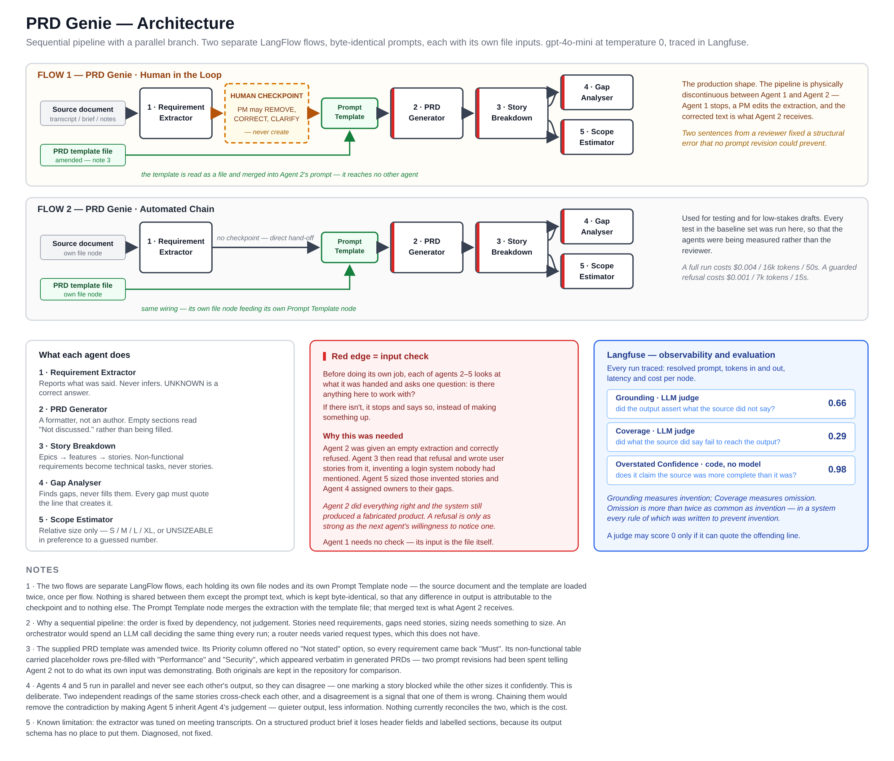

# PRD Genie

A five-agent pipeline that turns a product discussion into a PRD, a story breakdown,
a gap analysis and a scope estimate — and refuses to do any of it when the source
material doesn't support it.

Built in LangFlow on gpt-4o-mini at temperature 0, traced and evaluated in Langfuse.



---

## Submission

| | |
|---|---|
| **Demo video** | [Watch on Google Drive](https://drive.google.com/file/d/1AabJlZj-um5Z8PK3jhjXJ6UjpYUs3IkB/view) — walkthrough of the architecture, the failure that changed the build, and the evaluation results |
| **Tool walkthrough — automated chain** | [Watch](https://drive.google.com/file/d/1OfZUlmp24WAd3U7E2PQu9FDn_2vBt2LH/view?usp=sharing) — the five agents running end to end in LangFlow |
| **Tool walkthrough — human in the loop** | [Watch](https://drive.google.com/file/d/1iCLStHRL5qrcybEaD6ck0n1Z2k87lMfH/view?usp=sharing) — the checkpoint in the canvas, and the Langfuse traces and scores |
| **Slide deck** | [`docs/PRDGenie_Capstone_Deck.pptx`](docs/PRDGenie_Capstone_Deck.pptx) — narration in the speaker notes |
| **Q3 — Build** | [`docs/q3-writeup.md`](docs/q3-writeup.md) |
| **Q4 — Reflection** | [`docs/q4-reflection.md`](docs/q4-reflection.md) |

---

## The problem it addresses

A BA or PM turns meeting notes into a PRD, then into stories, then works out what is
missing and roughly how big it all is. The mechanical parts of that take hours. The
judgement parts take minutes.

The obvious move is to automate the mechanical parts. The difficulty is that a
language model asked to write a PRD from thin notes will write a *complete-looking*
PRD — inventing priorities, personas, acceptance criteria and dependencies that
nobody mentioned. A document that looks finished but contains invented requirements
is worse than no document, because a reviewer has no way to tell which lines came
from the meeting and which came from the model.

So the design goal was not "write a good PRD." It was: **never assert anything the
source did not say, and make it obvious where the gaps are.**

---

## What's actually interesting here

### 1. Structure beats rules

The single most useful finding. When an agent behaved wrongly, rewriting the *rules*
usually failed and restructuring the *output format* usually worked.

The clearest case: Agent 2 kept generating a full PRD from an empty extraction. Four
successive rule revisions — increasingly emphatic instructions not to — all failed.
Moving the refusal into the OUTPUT FORMAT section as a STEP 1 branch worked on the
first attempt:

```
STEP 1 — Read the "## Stated Requirements" section of the approved extraction.
If that section says "None", or is empty, or contains no concrete requirement,
then your ENTIRE output is exactly these three lines and nothing else:
[the refusal]
Then stop. Do not proceed to STEP 2.
```

A rule is something the model weighs against other rules. A branch in the output
format is something it follows.

The same pattern appeared in the Requirement Extractor. Two rules and a worked
example could not stop a performance constraint landing under Stated Requirements.
Moving the `## Non-Functional Requirements` heading *above* `## Stated Requirements`
in the output format fixed it, because the model fills sections in the order it
prints them.

### 2. Examples teach harder than rules — including the wrong lesson

Three rules told the Scope Estimator never to claim a source was complete. It kept
writing "fully specified in the source." The cause turned out to be its own
Example 1, which contained that exact phrase on a near-identical story, and a sizing
guide that defined S as "criteria fully specified." The prompt was teaching the
behaviour its rules forbade.

Agent 2's Example 5 leaked worse: a PRD about customer orders and invoices came back
containing the open question *"Is PDF export needed?"* — lifted straight out of the
example. Rewriting examples with bracketed placeholders (`[Person]`, `[Item A]`)
stopped it.

**The template counts as part of the prompt.** The supplied PRD template contained
placeholder rows reading `| NFR-001 | | Performance | |`. Those categories appeared
verbatim in generated PRDs. Two prompt revisions had been spent telling Agent 2 not
to invent categories it was being shown.

### 3. A refusal is only as strong as the next agent downstream

Agent 2 correctly refused an empty extraction and emitted a three-line notice. Agent
3 read that notice, treated it as a PRD, and wrote user stories for an authentication
system nobody had mentioned. Agent 5 sized those stories. Agent 4 assigned owners to
their gaps.

Agent 2 did everything right and the system still produced a fabricated product. The
fix was a STEP 1 input check on every one of agents 2–5: look at what you were
handed, and if there's nothing to work with, stop.

### 4. The human is an edge, not a node

The two flows differ by exactly one edge
([verified](docs/flow-verification.md), not asserted):

| | Automated Chain | Human in the Loop |
|---|---|---|
| Extractor → Prompt Template | present | **absent** |
| Chat Input → Prompt Template | absent | **present** |

In the human-in-the-loop flow the extractor's output goes to a display and nowhere
else. The rest of the pipeline is fed by a Chat Input, into which a reviewer pastes
the extraction they have approved or corrected. The two halves of the pipeline are
not connected to each other.

A prompt that says "wait for approval" can be ignored by the model. A missing edge
cannot.

### 5. The checkpoint made the system cheaper, not slower

Expected trade-off: a review step buys quality at the cost of throughput. Measured
result, on the same input:

| | Automated | With one PM correction | |
|---|---|---|---|
| Functional requirements | 4 | 2 | |
| Acceptance Criteria section | "Not discussed." | both present | |
| Gap Analyser questions | 8 | 4 | |
| — of which unanswerable | 2 | 0 | |
| Gap Analyser tokens | 9.4K | 7.0K | **−26%** |
| Gap Analyser latency | 34.8s | 19.7s | **−43%** |

The correction was two sentences: *the company logo requirement is an acceptance
criterion of the PDF export requirement, not a requirement of its own.* That is a
judgement the source material did not contain, so no prompt could have derived it.

The clearest evidence, same agent and same prompt in both runs:

> **Automated:** "What are the acceptance criteria for including the company logo in
> the PDF export?"
>
> **Human in the Loop:** "What specific details should be included in the PDF export
> beyond the company logo?"

The first asks for the acceptance criteria *of an acceptance criterion*, and marks it
BLOCKING. The second is a question a PM can answer.

---

## Results

Three evaluators scored every generation, backfilled across the full trace history.

| Evaluator | Type | Observations | Mean | |
|---|---|---|---|---|
| Grounding | LLM judge | 258 | **0.66** | did the output assert what the source did not say? |
| Coverage | LLM judge | 518 | **0.29** | did what the source did say fail to reach the output? |
| Overstated Confidence | code, no model | 259 | **0.98** | does it claim the source was more complete than it was? |

In all three, 1 is good. A judge may score 0 only if it can quote the specific
offending line — which makes the scores conservative, since a real failure the judge
cannot evidence is recorded as a pass.

**The headline is Coverage.** Every rule in all five prompts was written to prevent
invention. Measured, omission is more than twice as common. The two evaluators read
the same traceability requirement in opposite directions — grounding asks whether
every output line traces back, coverage asks whether every source item arrives — and
only the first was being designed for.

Coverage scored at every hop rather than only at ingestion, so 0.29 is loss *per
hop*, not loss from source document to final output.

Baseline test run: **13 of 14 tests passed**, with the failure (an invented
contradiction between two compatible statements) found by the tests rather than by
reading. Full detail in [docs/test-results.md](docs/test-results.md).

### Cost

| | Tokens | Latency | Cost |
|---|---|---|---|
| Full five-agent run | 16K | 50.4s | $0.004 |
| Guarded refusal | 7K | 14.5s | $0.001 |

Cost falls faster than token count because what a refusal eliminates is *output*
tokens, which are roughly four times the price of input tokens. 53% of input tokens
were served from prompt cache, since the system prompts never change between runs —
which halves the marginal cost of adding a rule.

---

## What's wrong with it

Diagnosed and deliberately not fixed, given the time available. Full list in
[docs/open-defects.md](docs/open-defects.md).

- **The extractor was tuned on meeting transcripts.** Given a structured product
  brief it loses header fields and labelled sections, because its output schema has
  nowhere to put them. This is the single biggest contributor to the Coverage score.
- **Agents 4 and 5 can contradict each other.** They run in parallel and never see
  each other's output, so one can mark a story blocked while the other sizes it
  confidently. This is deliberate — two independent readings cross-check each other,
  and chaining them would only make Agent 5 inherit Agent 4's judgement — but
  nothing reconciles the disagreement, and that is a real gap.
- **Priority invention returns on long real documents.** Clean on short test inputs;
  on a full brief the model starts deriving priority from modal verbs.
- **FR-008 vanished between Agent 2 and Agent 3** in one run and was not traced.
- **Five separate meetings flatten into one PRD** with no sense of chronology.

---

## Repository contents

```
README.md
docs/
  architecture.png / .svg     the diagram above
  q3-writeup.md               the Q3 build writeup
  q4-reflection.md            the Q4 reflection
  PRDGenie_Capstone_Deck.pptx the slide deck, narration in the speaker notes
  test-results.md             14-test baseline run, evaluator scores, HITL demo
  open-defects.md             every known defect, with cause and candidate fix
  flow-verification.md        proof the two flows differ by one edge and nothing else
  change-log.md               what changed, when, and why
flows/
  PRDGenie_AutomatedChain.json      LangFlow export, no credentials
  PRDGenie_HumanInTheLoop.json      LangFlow export, no credentials
prompts/
  00_prompt_template.md       the node that merges extraction + template
  01..05_*.md                 the five system prompts, extracted from the flow JSON
templates/
  prd_template.md             the amended PRD template Agent 2 is given
test-inputs/
  T1..T10                     the baseline test set
  heldout/H1..H3              written after the prompts were frozen
screenshots/
```

The prompt files were extracted programmatically from the flow export rather than
maintained by hand, so they cannot drift from what actually ran.

---

## Running it

1. Install [LangFlow](https://www.langflow.org/) and open it.
2. Import `flows/PRDGenie_AutomatedChain.json` (and the HITL flow).
3. Add your own OpenAI API key to each Language Model node. **The exports contain no
   credentials** — they were exported with "Save with my API keys" unchecked.
4. In the `Read File_Ingestion` node, upload any file from `test-inputs/`.
5. In the `Read File_PRD_template` node, upload `templates/prd_template.md`.
6. Run.

For the human-in-the-loop flow, the extractor's output appears in its Chat Output.
Copy it, correct it if needed, and paste it into the Chat Input to continue.

Tracing is optional. To enable it, set `LANGFLOW_LANGFUSE_*` environment variables
before starting LangFlow.

---

## A note on method

Every number in this repository came from a measurement, and several of them replaced
an earlier number that turned out to be wrong. Two examples, both recorded in the
change log:

- "The two flows produce different sizings at temperature 0" was claimed as evidence
  of nondeterminism. The inputs differed. Retracted.
- Per-agent costs were first assigned by reading position in the trace tree. Opening
  the nodes showed the mapping was reversed — the Scope Estimator is the expensive
  one, not the Gap Analyser.

Both were caught by checking rather than by reasoning more carefully, which is the
same lesson the evaluators taught: a plausible-looking output is not evidence of
anything.
